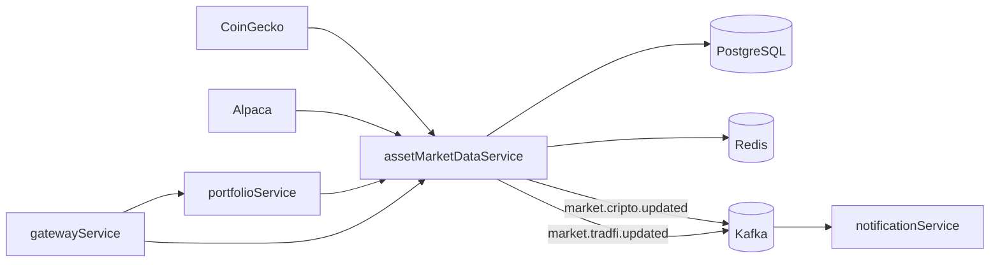

# assetMarketDataService

Serviço de catálogo e cotações de mercado do **ChainTracker**. Ele reúne dados de criptomoedas (CoinGecko) e de ações dos Estados Unidos (Alpaca), mantém um catálogo local em PostgreSQL, entrega consultas rápidas via cache Redis e publica atualizações de preço em tópicos Kafka para os demais serviços.

---

## Visão geral

O `assetMarketDataService` é a fonte de verdade de mercado do ecossistema. Suas responsabilidades são:

- sincronizar o catálogo das 100 maiores criptomoedas por valor de mercado;
- sincronizar o catálogo de ações `us_equity` ativas da Alpaca;
- manter cotações atualizadas de criptomoedas e de uma carteira fixa de 100 ações;
- servir consultas de catálogo, cotação individual e preços simplificados;
- publicar eventos `market.cripto.updated` e `market.tradfi.updated` para o `notificationService`;
- expor rotas internas e rotas específicas para o fluxo do bot.

O serviço **não** gerencia usuários, portfólios ou notificações. Essas responsabilidades pertencem ao `identity-service`, `portfolioService` e `notificationService`.

---

## Stack

| Item | Tecnologia |
|---|---|
| Linguagem / runtime | Java 21 |
| Framework | Spring Boot 4.1.1 |
| Build | Maven (wrapper `mvnw`) |
| HTTP | Spring Web MVC + `RestClient` |
| Persistência | Spring Data JPA + PostgreSQL 17 |
| Migrações | Flyway (`spring-boot-starter-flyway` + módulo PostgreSQL) |
| Cache | Redis (`spring-boot-starter-data-redis`) |
| Mensageria | Kafka (`spring-boot-starter-kafka`) |
| Segurança | Spring Security OAuth2 Resource Server (JWT do Keycloak) |
| Documentação | Springdoc OpenAPI + Swagger UI |
| Observabilidade | Actuator + Micrometer Prometheus |
| Produtividade | Lombok |

---

## Posição no ecossistema



- O **portfolioService** consulta o `assetMarketDataService` para obter metadados e preços atuais ao criar posições, calcular o resumo da carteira e validar alertas.
- O **notificationService** consome os eventos de mercado publicados pelo serviço para verificar alertas de preço.
- O **gatewayService** encaminha as rotas `/api/stock/**` e `/api/currency/**` para este serviço.

---

## Como funciona

### 1. Catálogo de criptomoedas

O `CryptoScheduler.refreshTop100()` executa a cada **30 segundos**:

1. consulta `GET https://api.coingecko.com/api/v3/coins/markets` com `vs_currency=usd`, ordenação por `market_cap_desc`, `per_page=100` e `page=1`;
2. para cada moeda, chama `CryptoAssetService.saveAsset(...)`;
3. grava no cache `coins:top100` (TTL de 1 minuto) e `coin:{id}` (TTL de 2 minutos);
4. publica cada moeda no tópico `market.cripto.updated`, usando o `id` da CoinGecko como chave.

O catálogo local (`crypto`) é alimentado apenas quando o `asset_id` ainda não existe. Nome e símbolo são copiados no momento da primeira inserção.

### 2. Consultas de criptomoedas

- `GET /api/currency` devolve a lista das 100 maiores. Se o cache `coins:top100` estiver vazio, dispara um refresh síncrono.
- `GET /api/currency/{id}` consulta `coin:{id}` no Redis (TTL de 1 minuto). Em caso de miss, busca `coins/markets?ids={id}` na CoinGecko, grava no cache e devolve o primeiro item. Se o provedor não retornar nada, responde `404`.
- `GET /api/currency/prices?ids=bitcoin,ethereum` usa o cache individual `coin:simple:{id}` (TTL de 1 minuto) e busca em lote apenas os ids ausentes no endpoint `/simple/price`, incluindo valor em USD, market cap, volume e variação de 24h.
- `GET /api/currency/data/{assetId}` devolve o registro do catálogo local (`CryptoDataResponse`), com cache `coin.data:{assetId}` de **10 minutos**. O `assetId` é normalizado para minúsculas.

### 3. Catálogo de ações

O `StockScheduler.refreshCatalog()` executa a cada **24 horas** (`86400000 ms`):

1. chama `AlpacaAssetClient.updateUsEquity()`;
2. consulta `GET {alpaca.trading-url}/assets?status=active&asset_class=us_equity`;
3. faz upsert em lote na tabela `stock`, usando `symbol` como chave de conflito e atualizando `name`, `exchange` e `active`.

A consulta `GET /api/stock/{symbol}` do catálogo estático normaliza o símbolo para maiúsculas, usa o cache `stock.data:{symbol}` (TTL de **4 horas**) e responde `404` quando o símbolo não existe na tabela.

### 4. Cotações de ações

O `StockScheduler.refreshTop100()` executa a cada **15 segundos**:

1. consulta a Alpaca Data API em `/stocks/snapshots` para uma lista fixa de 100 símbolos, com `feed=iex`;
2. converte cada snapshot em `StockMarketResponse`:
   - `latestTrade.p` → `currentPrice`;
   - `dailyBar.o` → `openingPrice`;
   - `dailyBar.h` → `highestPrice`;
   - `dailyBar.l` → `lowestPrice`;
3. grava `stock:{symbol}` e `stocks:top100` no Redis (TTL de 3 minutos);
4. publica cada símbolo em `market.tradfi.updated`, usando o próprio símbolo como chave.

A consulta individual `GET /api/stock/{symbol}` usa o cache `stock:{symbol}`. Em caso de miss, busca `/stocks/{symbol}/snapshot?feed=iex`, grava no cache por 3 minutos e publica o evento correspondente.

A lista de ações acompanhadas é fixa no código (`AlpacaDataClient`):

```
NVDA, AAPL, MSFT, AMZN, GOOGL, GOOG, META, AVGO, TSLA, MU,
BRK.B, LLY, AMD, JPM, WMT, V, XOM, JNJ, INTC, MA,
... (100 símbolos no total)
```

### 5. Cache

| Chave | Conteúdo | TTL |
|---|---|---|
| `coins:top100` | lista das 100 maiores criptomoedas | 1 min |
| `coin:{id}` | cotação individual de cripto | 1–2 min |
| `coin:simple:{id}` | preço simplificado de cripto | 1 min |
| `coin.data:{assetId}` | registro do catálogo local de cripto | 10 min |
| `stocks:top100` | mapa das 100 ações acompanhadas | 3 min |
| `stock:{symbol}` | cotação individual de ação | 3 min |
| `stock.data:{symbol}` | registro do catálogo local de ação | 4 h |

A serialização usa `StringRedisSerializer` para chaves e `GenericJacksonJsonRedisSerializer` para valores.

### 6. Eventos Kafka publicados

| Tópico | Chave | Conteúdo | Quando |
|---|---|---|---|
| `market.cripto.updated` | `id` da CoinGecko | `CryptoMarketResponse` | a cada refresh de cripto (30 s) e em consultas sem cache |
| `market.tradfi.updated` | símbolo da ação | `StockMarketResponse` | a cada refresh de ações (15 s) e em consultas sem cache |

---

## Integrações externas

| Provedor | Base URL | Endpoints usados | Autenticação |
|---|---|---|---|
| CoinGecko | `https://api.coingecko.com/api/v3/` | `/coins/markets`, `/simple/price` | header `x-cg-demo-api-key` |
| Alpaca Trading | `https://paper-api.alpaca.markets/v2/` | `/assets` | headers `APCA-API-KEY-ID` e `APCA-API-SECRET-KEY` |
| Alpaca Data | `https://data.alpaca.markets/v2/` | `/stocks/snapshots`, `/stocks/{symbol}/snapshot` | headers `APCA-API-KEY-ID` e `APCA-API-SECRET-KEY` |

Os valores de URL e credenciais vêm de `application.yaml` e de variáveis de ambiente.

---

## Modelo de dados

### Tabela `crypto`

| Coluna | Tipo | Observação |
|---|---|---|
| `id` | `uuid` | chave primária |
| `asset_id` | `varchar(255)` | id externo da CoinGecko |
| `name` | `varchar(255)` | nome da moeda |
| `symbol` | `varchar(255)` | ticker |
| `active` | `boolean` | indicação de atividade |

### Tabela `stock`

| Coluna | Tipo | Observação |
|---|---|---|
| `id` | `uuid` | chave primária |
| `symbol` | `varchar(255)` | único |
| `name` | `varchar(255)` | nome da empresa |
| `exchange` | `varchar(255)` | bolsa |
| `active` | `varchar(255)` | status retornado pela Alpaca |

A migração `V1__cria_tabelas_de_ativos.sql` cria as duas tabelas com `IF NOT EXISTS`. O Flyway está configurado com `baseline-on-migrate: true` e `baseline-version: 0`, permitindo adotar bancos que já tenham sido criados pelo Hibernate. O JPA roda com `ddl-auto: validate`: o schema é responsabilidade das migrações.

---

## API HTTP

Todas as rotas ficam sob `/api`. A porta interna do serviço é **8082**.

### Autenticação

- As rotas exigem um Bearer token JWT válido do realm `ChainTracker` do Keycloak.
- As rotas sob `/api/bot/**` exigem a authority `SCOPE_bot`.
- A rota `/error` é liberada para preservar mensagens de erro internas do Spring.

### Rotas de ações

| Método | Caminho | Descrição |
|---|---|---|
| `GET` | `/api/stock` | mapa com as 100 ações acompanhadas |
| `GET` | `/api/stock/{symbol}` | cotação individual da ação |

Exemplo de resposta de `GET /api/stock/AAPL`:

```json
{
  "symbol": "AAPL",
  "currentPrice": 231.45,
  "openingPrice": 229.10,
  "highestPrice": 232.80,
  "lowestPrice": 228.55
}
```

### Rotas de criptomoedas

| Método | Caminho | Descrição |
|---|---|---|
| `GET` | `/api/currency` | lista das 100 maiores criptomoedas |
| `GET` | `/api/currency/{id}` | cotação individual pelo id da CoinGecko |
| `GET` | `/api/currency/prices?ids=...` | preços simplificados em lote |
| `GET` | `/api/currency/data/{assetId}` | registro do catálogo local |

Exemplo de resposta de `GET /api/currency/bitcoin`:

```json
{
  "id": "bitcoin",
  "symbol": "btc",
  "name": "Bitcoin",
  "current_price": 67432.15,
  "market_cap": 1329000000000,
  "market_cap_rank": 1,
  "price_change_percentage_24h": 2.34,
  "last_updated": "2026-10-26T12:00:00.000Z"
}
```

Exemplo de resposta de `GET /api/currency/prices?ids=bitcoin,ethereum`:

```json
{
  "bitcoin": {
    "usd": 67432.15,
    "usd_market_cap": 1329000000000,
    "usd_24h_vol": 28900000000,
    "usd_24h_change": 2.34,
    "last_updated_at": 1761489600
  },
  "ethereum": {
    "usd": 2489.70,
    "usd_market_cap": 299000000000,
    "usd_24h_vol": 14200000000,
    "usd_24h_change": 1.12,
    "last_updated_at": 1761489600
  }
}
```

### Rotas internas

| Método | Caminho | Descrição |
|---|---|---|
| `GET` | `/api/internal/data/stock/{symbol}` | metadados da ação no catálogo local |
| `GET` | `/api/internal/data/currency/{assetId}` | metadados da cripto no catálogo local |

### Rotas do bot

As rotas abaixo são cópias das consultas de mercado usadas pelo fluxo do Telegram. Elas existem para que o `portfolioService`, quando atende uma requisição `/api/bot/**`, consulte o mercado com o token de serviço de escopo `bot`.

| Método | Caminho | Descrição |
|---|---|---|
| `GET` | `/api/bot/currency` | lista das 100 maiores criptomoedas |
| `GET` | `/api/bot/currency/{id}` | cotação individual de cripto |
| `GET` | `/api/bot/currency/{id}/data` | metadados da cripto |
| `GET` | `/api/bot/stock/{symbol}` | cotação individual de ação |
| `GET` | `/api/bot/stock/{symbol}/data` | metadados da ação |

---

## Documentação OpenAPI

O serviço gera a especificação OpenAPI a partir dos controllers e publica o Swagger UI.

| Recurso | URL |
|---|---|
| Swagger UI direto | `http://localhost:3003/swagger-ui.html` |
| Especificação JSON | `http://localhost:3003/v3/api-docs` |
| Swagger UI pelo gateway | `http://localhost:3006/swagger-ui.html` (selecione `assetMarketDataService`) |

Na interface, use o botão **Authorize** com um Bearer token do Keycloak. As rotas `/api/bot/**` exigem um token de serviço com o escopo `bot`.

---

## Segurança

- O serviço atua como **resource server**: valida a assinatura e o emissor do JWT usando o `issuer-uri` do Keycloak (`http://keycloak:8080/realms/ChainTracker`).
- `SecurityConfiguration` libera apenas `/error`, exige `SCOPE_bot` em `/api/bot/**` e exige autenticação nas demais rotas.
- O serviço não emite tokens; a emissão é responsabilidade do Keycloak.

---

## Configuração

Arquivo principal: `src/main/resources/application.yaml`.

| Propriedade | Valor padrão | Origem |
|---|---|---|
| `server.port` | `8082` | arquivo |
| `spring.datasource.url` | `jdbc:postgresql://assetData-service-db:5432/assetDataService` | arquivo |
| `spring.datasource.username` | `user` | arquivo |
| `spring.datasource.password` | `postgres` | arquivo |
| `spring.data.redis.host` | `my-redis` | arquivo |
| `spring.data.redis.port` | `6379` | arquivo |
| `spring.data.redis.password` | `admin` | arquivo |
| `spring.kafka.bootstrap-servers` | `kafka:9092` | arquivo |
| `spring.security.oauth2.resourceserver.jwt.issuer-uri` | `http://keycloak:8080/realms/ChainTracker` | arquivo |
| `coingecko.url` | `https://api.coingecko.com/api/v3/` | arquivo |
| `coingecko.api-key` | — | variável `COINGECKO_KEY` |
| `alpaca.trading-url` | `https://paper-api.alpaca.markets/v2/` | arquivo |
| `alpaca.url` | `https://data.alpaca.markets/v2/` | arquivo |
| `alpaca.api-key` | — | variável `ALPACA_KEY` |
| `alpaca.api-secret` | — | variável `ALPACA_SECRET` |

Variáveis de ambiente usadas no `docker-compose.yaml` do repositório `ChainTracker`:

```bash
COINGECKO_KEY=...
ALPACA_KEY=...
ALPACA_SECRET=...
```

---

## Como executar

### Localmente

Pré-requisitos: Java 21, PostgreSQL, Redis, Kafka e um Keycloak com o realm `ChainTracker`.

```bash
# na raiz do repositório
export COINGECKO_KEY=...
export ALPACA_KEY=...
export ALPACA_SECRET=...

./mvnw spring-boot:run
```

O serviço sobe em `http://localhost:8082`.

### Com Docker

```bash
./mvnw clean package -DskipTests

docker build -t assetmarketdata-service .
docker run --rm -p 8082:8082 \
  -e COINGECKO_KEY=... \
  -e ALPACA_KEY=... \
  -e ALPACA_SECRET=... \
  assetmarketdata-service
```

### No stack completo

No repositório `ChainTracker`, o serviço é construído a partir do diretório `./assetMarketDataService` e exposto na porta **3003** do host, mapeada para a **8082** do container.

---

## Estrutura do projeto

```text
assetMarketDataService/
├── src/main/java/ChainTracker/assetMarketDataService/
│   ├── client/          # clientes HTTP (Alpaca e CoinGecko)
│   ├── config/          # Redis, RestClient e Security
│   ├── controller/      # rotas HTTP
│   ├── dto/             # contratos de entrada e saída
│   ├── mapper/          # conversões entre entidades, DTOs e respostas externas
│   ├── model/           # entidades JPA
│   ├── repository/      # repositórios Spring Data
│   ├── scheduler/       # refresh periódico de catálogo e cotações
│   └── service/         # regras de negócio
├── src/main/resources/
│   ├── application.yaml
│   └── db/migration/    # migrações Flyway
├── Dockerfile
├── pom.xml
└── mvnw / mvnw.cmd
```

---

## Observabilidade

- `spring-boot-starter-actuator` expõe os endpoints padrão de health e métricas.
- `micrometer-registry-prometheus` publica métricas no formato Prometheus.
- Os logs do refresh periódico e das chamadas aos provedores externos saem no console da aplicação.
